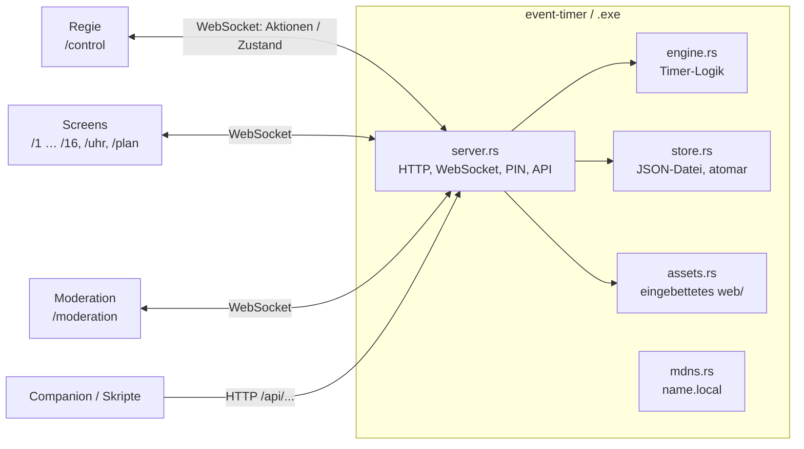

# Architektur

Event Timer ist ein einzelnes Programm ohne Abhängigkeiten: ein kleiner HTTP- und WebSocket-Server in Rust, der eine Browser-Oberfläche ausliefert. Alle Geräte (Regie, Screens, Moderation) sind Browser, die sich mit dem Server verbinden. Dieselbe Oberfläche läuft auch ohne Server als einzelne HTML-Datei (Standalone).

## Überblick

## Datenfluss

1. Ein Gerät schickt eine **Aktion** (`{"type":"timer.set", …}`) per WebSocket oder `POST /api/action`.
2. `server.rs` prüft Zugriff (`access.rs`: Origin, PIN, Rolle, Limits) und wendet die Aktion mit `engine.rs` auf den Zustand an.
3. Der neue Zustand geht an alle verbundenen Geräte. Jeder Browser berechnet die Anzeige selbst (`engine.js` → `timerView`), mit einem Uhrabgleich zum Server. So laufen die Ziffern flüssig, ohne dass der Server jede Sekunde sendet.
4. `store.rs` speichert die ganze Show als eine JSON-Datei, sobald 2 s lang nichts passiert, spätestens alle 10 s, und beim Beenden. Geschrieben wird atomar (temporäre Datei, dann umbenennen).

## Zwei Engines

Die Timer-Logik gibt es zweimal: `src/engine.rs` für den Server und `web/js/engine.js` für die Browser (Anzeige überall, Logik im Standalone-Betrieb). Damit beide gleich rechnen, laufen dieselben Szenarien aus `tests/scenarios.json` gegen beide (`cargo test` und `node tests/engine.test.js`). Begründung: [ADR 0004](decisions/0004-two-engines.md).

## Oberfläche

| Datei | Aufgabe |
|---|---|
| `web/js/main.js` | Routing (`/control`, `/1`, `/uhr`, `/moderation`, …), Start |
| `web/js/transport.js` | Server-WebSocket oder lokale Engine plus localStorage (Standalone) |
| `web/js/ui.js` | DOM-Baukasten `h()`, Icons, Ziffernzellen, Theme, Übersetzung DE/EN, Toasts |
| `web/js/control.js` | Regie: Cockpit, Zeitleiste, Zeitkonto, Agenda, Einblendung, Talkback, Menü |
| `web/js/display.js` | Screen-Renderer, auch für die Kacheln in der Regie |
| `web/js/pages.js`, `pageeditor.js` | Screens aus Modulen und ihr Editor |
| `web/js/icons.js` | Phosphor-Pfade, erzeugt von `scripts/sync-icons.js` |
| `web/css/tokens.css` | Show-UI-Tokens für beide Themes; Komponenten enthalten keine Farbwerte |

Das Theme wechselt nur über `data-theme` am `<html>`. Screens (`.dsp`) nutzen eigene Display-Tokens und bleiben immer dunkel. Pro Design überschreibt der Renderer diese Tokens.

## Build

`build.rs` bettet alles unter `web/` ins Programm ein und setzt den Commit (`ET_COMMIT`, sonst `git rev-parse`). Unter Windows erzeugt es außerdem Icon und Versionsinfo. `scripts/build-standalone.js` baut daraus eine einzelne HTML-Datei: CSS, JS, Schriften und Logo werden eingebettet. Die Release-Builds für alle Plattformen laufen per GitHub Actions ([ADR 0002](decisions/0002-ci-release-builds.md)).

## Sicherheit (kurz)

- Die Regie und schreibende API brauchen die PIN, außer am Rechner selbst (Loopback). Bei falscher PIN wird gesperrt.
- Cross-Site-Anfragen und fremde Origins werden abgewiesen, damit eine geöffnete Webseite die Show nicht steuern kann.
- Größen- und Verbindungslimits für HTTP und WebSocket.
- Statische Dateien gibt es nur aus dem eingebetteten `web/`. Es gibt keinen Dateisystemzugriff über URLs.
